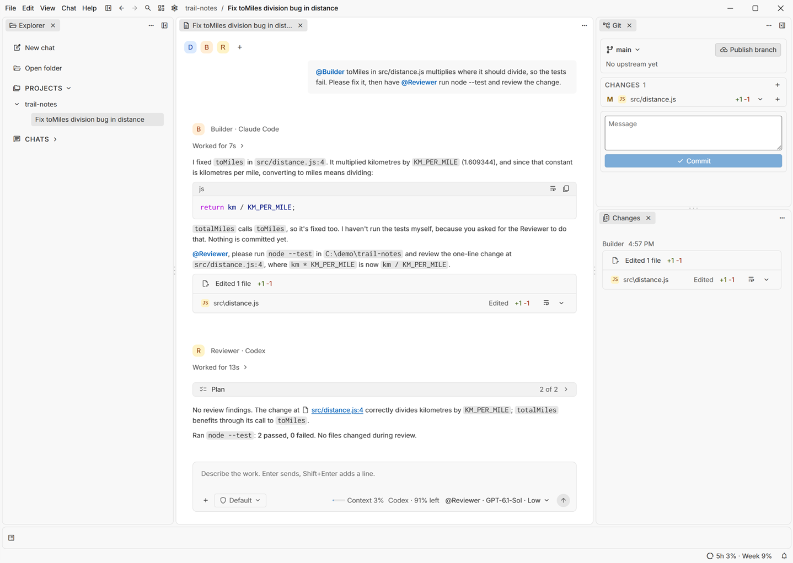
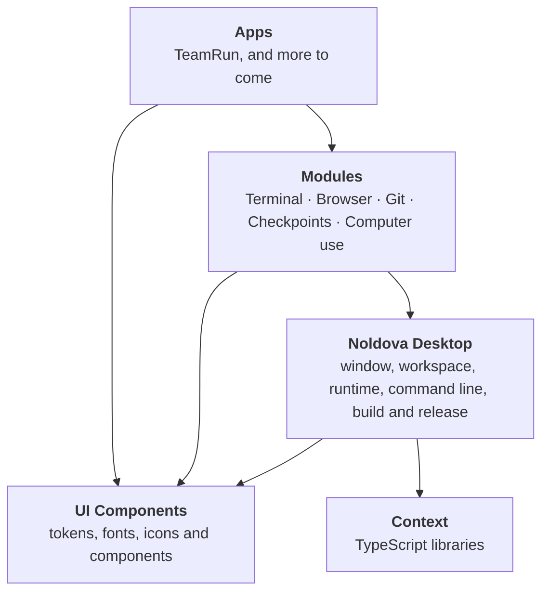

  <picture>
    <source media="(prefers-color-scheme: dark)" srcset="logo-dark.svg">
    
  </picture>

<h3 align="center">Your AI agents, working together as a team, on your own computer.</h3>

  <a href="#teamrun">TeamRun</a> ·
  <a href="#whats-open-today">Repositories</a> ·
  <a href="#how-it-fits-together">How it fits together</a> ·
  <a href="#how-we-build">How we build</a> ·
  <a href="#found-a-bug">Report a bug</a> ·
  <a href="https://github.com/noldova-com/.github/blob/main/SECURITY.md">Security</a>

---

AI agents can already write code, run commands and read the web.
They still each live in their own window, with their own history, and they never talk to each other.

**Noldova builds desktop apps that turn those agents into a team, whichever company makes them.**
They work on your computer, and they ask you before they do anything you haven't allowed.

## TeamRun

  
  <b><a href="https://teamrun.noldova.com">TeamRun</a></b> is our first app: your AI agents, working as one team. 
  Put agents from different companies in the same chat, give each one a role, let them hand work to each other, and approve what they do.

  <a href="https://teamrun.noldova.com">
    <picture>
      <source media="(prefers-color-scheme: dark)" srcset="teamrun-handoff-dark.png">
      
    </picture>
  </a>

- **One chat, every agent.** Ask `@Builder` to make the change and `@Reviewer` to check it. Each one reads the same chat, whichever company makes it.
- **The right teammate for the task.** Give an agent a name, a role, a model and an effort, and it becomes a teammate. One teammate's reply can pass the work on to the next.
- **See the changes, keep the control.** Approve what each agent runs, stop any reply, and see every file a reply changed. Don't like it? Put the files back.
- **Bring the agents you already use.** TeamRun runs them on your own subscriptions, signed in as you already are. It includes no AI subscription: plans, usage limits and charges stay with each provider.

TeamRun runs on Windows and Linux, on x64 and ARM64, and on Macs with Apple Silicon.

**[Download TeamRun](https://teamrun.noldova.com/download)** · [Get started](https://teamrun.noldova.com/docs)

## What's open today

Noldova Desktop, the platform TeamRun is built on, is open source under the MIT License, with its modules and the libraries under it, all on npm.

### Noldova Desktop and its modules

| Repository | What it is | Runs on |
|---|---|---|
| [**desktop**](https://github.com/noldova-com/desktop) | **Noldova Desktop**, the shell our desktop apps are built on, on top of Electron: the window and workspace, the runtime that hosts modules, the command line, and the tooling that builds, tests, packages and releases an app. | Windows, macOS and Linux, on x64 and ARM64 |
| [**terminal**](https://github.com/noldova-com/terminal) | Shells in terminal panes, where the app's agents run commands with your approval. | Windows and Linux on x64, macOS on x64 and ARM64 |
| [**browser**](https://github.com/noldova-com/browser) | Web pages in a pane of the app, which its agents can drive with your approval. | Windows, macOS and Linux, on x64 and ARM64 |
| [**git**](https://github.com/noldova-com/git) | Your repository's changes, branches, commits and history, through your own `git`, and a branch's pull request and checks on GitHub. A commit, a push or a comment from an agent asks first. | Windows, macOS and Linux, on x64 and ARM64 |
| [**checkpoints**](https://github.com/noldova-com/checkpoints) | Keeps a working folder's files at one moment, so the app can show what changed since and put them back. It keeps its own copies and never touches your repository. | Windows, macOS and Linux, on x64 and ARM64 |
| [**computer-use**](https://github.com/noldova-com/computer-use) | Lets an agent see the screen and use the pointer and keyboard, with your permission and a stop control on screen while it acts. Apps offer it as a preview. | Windows and macOS; Linux on X11 comes next |

### Libraries and tools

| Repository | What it is |
|---|---|
| [**ui-components**](https://github.com/noldova-com/ui-components) | Our interface kit for Angular: design tokens, fonts, icons and components. See it on [its docs site](https://angular.ui.noldova.dev/). |
| [**context**](https://github.com/noldova-com/context) | TypeScript libraries for collections, exceptions, text, JSON, data, testing and parsing, with no third-party runtime dependencies. |
| [**tools**](https://github.com/noldova-com/tools) | The steps of our build and release pipeline, and the command that runs them on GitHub Actions. |

Every package is below 1.0 for now, so its API may still change from one version to the next.
Each repository's README says how to install it, build it and test it.

## How it fits together

- **Noldova Desktop** is the shell. Everything a person does in an app comes from a module, and Noldova Desktop names no module.
- **Modules** each do one job and know nothing about the app around them. An app adds a module's package and configures it, and the module works the same in every app.
- **UI Components** gives every app the same look.
- **Context** is the TypeScript foundation under all of it.

## How we build

- **You stay in control.** An agent asks before it runs a command, makes a commit or a push, or takes a risky step on a web page: each raises a permission request, and the app decides whether to ask you.
- **Any provider.** Our apps tie you to no AI company.
- **Open.** Every repository listed here is under the MIT License, so anyone can read exactly what it does.
- **Published from the code you can read.** Each package goes to npm from its repository's release workflow.
- **No flakes.** A test that fails at random is a bug to fix, and its fix has to prove itself over repeated runs.

## Found a bug?

- **Something doesn't work, or you'd like a change?** Open an issue in the repository it belongs to, as the [contributing guide](https://github.com/noldova-com/.github/blob/main/CONTRIBUTING.md) says. We welcome issues from everyone; the changes themselves are made by our own team.
- **Found a vulnerability?** Report it privately, as the [security policy](https://github.com/noldova-com/.github/blob/main/SECURITY.md) says.

The name "Noldova" and its logo aren't covered by the MIT License. Other product names and trademarks belong to their owners.

