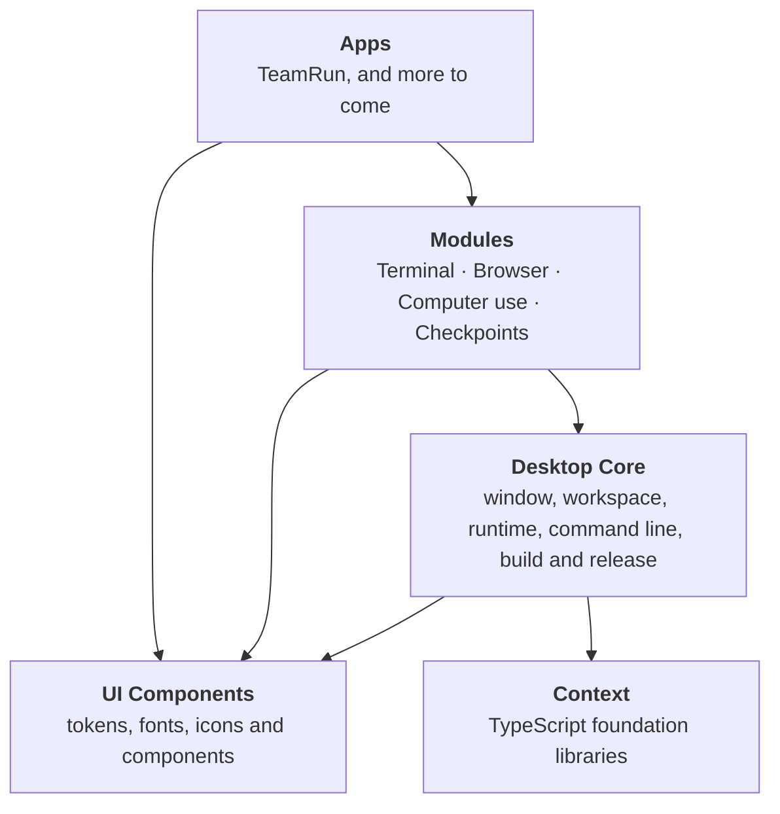

  <picture>
    <source media="(prefers-color-scheme: dark)" srcset="logo-dark.svg">
    
  </picture>

<h3 align="center">Your AI agents, working together as a team, on your own computer.</h3>

  <a href="#teamrun">TeamRun</a> ·
  <a href="#one-platform-many-apps">Platform</a> ·
  <a href="#open-source">Open source</a> ·
  <a href="https://github.com/noldova-com/.github/blob/main/CONTRIBUTING.md">Contributing</a> ·
  <a href="https://github.com/noldova-com/.github/blob/main/SECURITY.md">Security</a>

---

AI agents can already write code, run commands and read the web.
They still each live in their own window, with their own history, and they never talk to each other.
You end up copying text between them, watching each one separately, and remembering which one knows what.

**Noldova builds apps that turn those agents into a team, whichever company makes them.**
They share chats, hand work to each other, and ask you before they do anything you haven't allowed, all on your machine.
No provider is favored: you pick the agent and the model for each teammate, and they all work the same way, side by side.

## TeamRun

**TeamRun** is an app where you and your AI agents work in the same chats.

- **Teammates, not tabs.** Give an agent a name, a role, a model and an effort level, and it becomes a teammate. Mention `@reviewer` in a chat and that teammate answers. Agents from different providers sit in the same chat and read the same history.
- **They work with each other.** A teammate can start a chat, bring in another teammate, hand over a task and read the answer. One reply that mentions another teammate passes the work on.
- **You decide what runs.** Every action an agent wants to take raises a request you can see, allow or refuse. Choose per teammate how much it may do without asking, and stop any reply at any moment.
- **Bring the agents you already use.** TeamRun drives the coding agents you're already signed in to, with your own subscriptions, and shows their thinking, tool calls, plans and sub-agents in one consistent view, whichever provider they come from.
- **A real workspace around the chat.** A terminal where agents run commands with your approval, a browser they can drive, checkpoints that show what changed in your files and put them back, and, in preview, computer use with a stop control on screen while the agent acts.
- **Your data stays yours.** Chats, teammates and settings live on your computer.  
- **Fast with long work.** A chat with ten thousand messages, files and edits opens and scrolls without waiting.
- **Scriptable.** The `teamrun` command line sends messages, manages teammates and reads chats, so you can drive your team from scripts and other tools.

TeamRun runs on **Windows, macOS and Linux**, on **x64 and ARM64**.

## One platform, many apps

TeamRun is the first app built on our own desktop platform.
Everything you see in it is a module, and the same modules work in every app built on the platform.

- **Desktop Core** is the shell: the window and workspace, the runtime that hosts modules, the command line, and the tooling that builds, tests, packages and releases an app. It names no app and no module.
- **Modules** each do one job well and know nothing about the app around them. An agent reaches them through tools, and the person approves what they do.
- **UI Components** gives every app the same look: design tokens, fonts, icons and components, in light and dark themes and the system's high-contrast mode.
- **Context** is the TypeScript foundation under all of it: collections, text, JSON, diagnostics, parsers and our own test framework.

## How we build

- **Any provider.** Our apps tie you to no AI company: each teammate runs on the provider and model you choose, with your own subscription, and all of them share one chat and one way of working.
- **You stay in control.** An agent asks before it acts, you see what it does while it does it, and you can stop it or put your files back.
- **Local first.** Your work and your history stay on your machine.  
- **Open.** We're opening our apps and the platform under them, one repository at a time, under the MIT license, so anyone can read exactly what they do with your data and your subscriptions.
- **Built to last.** Small packages with clear boundaries and typed APIs, and every change comes with tests that CI runs before it merges.
- **No flakes.** A test that fails at random is treated as a bug, and its fix has to prove itself over many runs.
- **Accessible.** Every screen is built to work from the keyboard, and we check our work against WCAG.

## What's next

- **Git and GitHub** in the workspace, so teammates can branch, commit and open pull requests with you watching.
- **Local and open models** as teammates, next to the hosted ones.
- **Teammates on other machines,** so a team can use a more powerful computer while you watch from yours.
- **More apps** on the same platform and modules.

## Open source

We're making our repositories public one at a time, and each one is listed here as it opens.
Each repository's README says how to build it, test it and run it.

- **Found a bug or have an idea?** Open an issue in the repository it belongs to, as [contributing](https://github.com/noldova-com/.github/blob/main/CONTRIBUTING.md) explains.
- **Found a vulnerability?** Report it privately, as the [security policy](https://github.com/noldova-com/.github/blob/main/SECURITY.md) says.

Product names and trademarks of AI providers belong to their owners.

